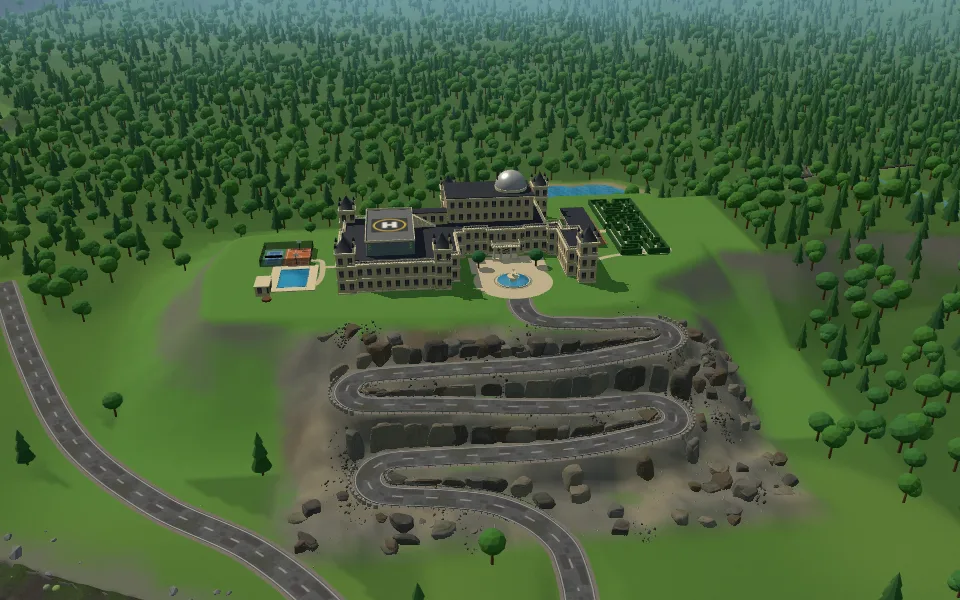

# Wayne Manor 3D

Wayne Manor als begehbare 3D-Szene im Browser (three.js 0.160, eine Datei `index.html`, keine Build-Tools).
Gebaut nach den Lageplaenen in `karten/` (Aussenanlage, Nebengeschosse, oberes und unteres Level der Hoehle)
und den Skizzen unter `karten/planung/`. Bauplan und Stand der einzelnen Schritte: `PLAN.md`.

## Inhalt

- **Anwesen auf einem Plateau (25 m):** Schloss mit Ecktuermen, Glasdach, Theater, Observatorium und Landeplatz,
  Rondell mit Brunnen, Heckenlabyrinth, Pool, Poolhaus, Tennis- und Basketballplatz, Tiefgarage mit Stellplaetzen.
- **Zufahrt:** Serpentine im Stil einer Alpenpassstrasse den Osthang hinunter, schraeges Einfahrtstor mit Torhaus, Grundstuecksmauer mit Westtor und zwei verfallenen Luecken im Wald,
  geschwungene Hauptstrasse zwischen Plateau und Steilkueste.
- **Batcave, zwei Ebenen:** oben Forschung und Waffenkammer, Hangars mit Jets, Vorraum mit Hangartor;
  unten drehende Tiefgarage, Medical Bay, Auto Repair mit Auffahr-Hebebuehne, Hoehlensee mit Steg und Boot,
  Felstor zum Lake Exit, Wassertunnel zur Steilkueste, Tunnel nach Gotham und zum Waterfall Exit.
- **Autoaufzug** Garage - Hangfuss - Batcave (mit Drehteller), Personenaufzug vom Haus bis in die Hoehle.
- **Garagenrampe**: Klappe im Rasen oestlich vom Haus senkt sich zur Rampe, unten Wendeplatz und Rolltor in die Tiefgarage (Rechtsklick/E, im Fahrzeug L).
- **Landschaft:** Steilkueste mit Felswand, Wasserhoehlen und Felsnadeln, Bucht mit Landzungen, Wasserfall,
  Wald, Seen, Meer mit Wellen; Tag und Nacht.

## Bedienung

| Was | PC | Handy |
| --- | --- | --- |
| Umschauen (Orbit) | Ziehen, Mausrad | Wischen, zwei Finger |
| Rechtsklick (Orbit) | Menue an der Maus: Koordinaten kopieren oder hierhin teleportieren | |
| Begehen | Knopf "Begehen", Linksklick faengt die Maus, WASD, Leertaste springt, Shift rennt | Joysticks, Sprung-Knopf |
| Geist (fliegen) | Knopf "Geist" oder Taste G (G im Geist = hier begehen), WASD waagrecht, Leertaste hoch, C runter, Shift schneller, E/Rechtsklick Tor/Tuer/Hebebuehne | Joysticks, Sprung/Runter |
| Tore, Hebebuehne | Zielen, Rechtsklick oder E | Hinweis antippen |
| Aufzuege | Rechtsklick auf die Aufzugtuer holt ihn (bzw. faehrt im Aufzug weiter); im Aufzug Tasten 1-5 oder Pfeile, Anzeige rechts | Hinweis bzw. Anzeige antippen |
| Boot | Rechtsklick einsteigen, Shift aussteigen, W/S Gas, A/D lenken, V Kamera (hinten/Fahrersicht) | Joysticks |
| The Bat (Batwing, fliegt) | In der Batcave beim Batcomputer oder ueber das T-Menue holen; Rechtsklick einsteigen, Shift aussteigen (nur gelandet), W/S vor/zurueck, A/D drehen, Leertaste steigen, C sinken, V Kamera hinten/Cockpit, M Ton. Hinaus ueber den See und den Wassertunnel aufs Meer | Joysticks, Sprung/Runter |
| Fahrzeuge (Tumbler, Rolls-Royce, Motorrad, Batpod, Boxer-Streetfighter, Gotham Taxi, Gotham Police, Nachtfalke, Aventador, G-Klasse) | Rechtsklick aufs Fahrzeug einsteigen, Shift aussteigen (E nicht mehr), W/S (nur W, kein Shift), A/D, Leertaste Sprung (Tumbler und Batpod, ab 50 km/h) bzw. Nitro halten (Nachtfalke, Leiste zeigt den Vorrat), V Kamera, R zuruecksetzen, L Autoaufzug, 1-3 Halt, M Motorton an/aus; in der Tiefgarage auf einen freien Stellplatz zielen (P-Schild), Rechtsklick parkt mit dem Heck zur Wand ein | Joysticks, Sprung-Knopf |
| Vollbild | Knopf "Vollbild" oder F; sperrt Strg+W (Chrome/Edge), Esc gedrueckt halten zum Verlassen | |
| Karten | Knopf "Karte" blendet die Lageplaene ein | |
| Von unten | Knopf "Von unten": Blick unter das Gelaende auf Garage und Hoehle | |

Esc beendet Begehen, Geist und Fahren. Taste T oder die Auswahl "Teleport (Test)" springt zu festen Zielen
(Testhilfe, wird spaeter entfernt).

## Entwickeln

- Aufbau: `index.html` (nur HTML, laedt three.js und startet die Skripte), `style.css`, Code in `js/` nach Themen in Ordnern:
  `kern/` (Grundgeruest, Tag/Nacht, Tore, Bildschleife, Start), `gelaende/`, `strassen/`, `haus/`, `aussen/`, `aufzuege/`, `hoehle/`, `spieler/`, `ui/`, `fahrzeuge/`.
  Die Skripte sind klassische Skripte mit gemeinsamem globalem Bereich; die Reihenfolge steht in `FILES` in `index.html`.
  Neue Datei: dort und in `ASSETS` in `../../sw.js` eintragen.

- Lokal ueber http starten (Service Worker), z. B. im Projektordner `python -m http.server 8080`.
- `?debug` stellt `window.manorDebug` bereit (Spieler, Wege, Aufzuege, Boot, Auto, Tore) zum Testen ohne Maus.
- Nach jeder Aenderung `CACHE` in `../../sw.js` hochzaehlen.

---

Erstellt von [Nicolas Brand](https://n-brand.github.io/portfolio/)
